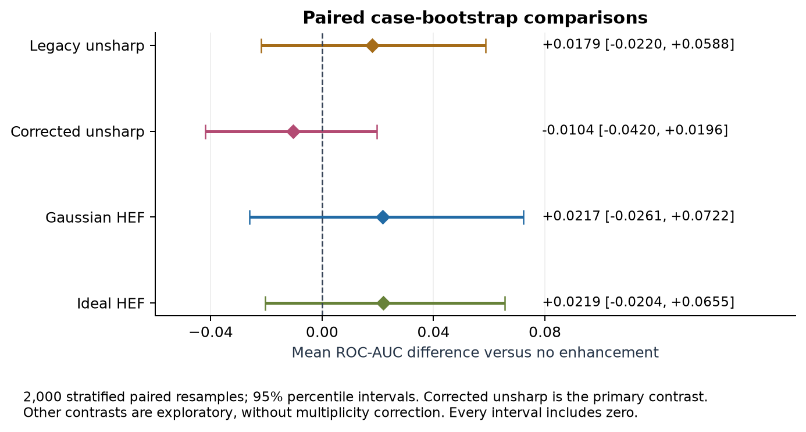

# Chest X-ray Enhancement for Tuberculosis Classification

A reproducible research framework for testing whether image enhancement changes the classification of normal versus TB-consistent chest radiographs. The project rebuilds and audits Mohammad Albatayneh's supplied digital image processing course project while preserving its research objective and original evidence.

**Status: the user completed the 15-run Colab study, and the returned evidence was independently checked on 2026-10-19.** All 167 archive-member checksums, external and validation metrics for all 15 runs, and the 2,000-resample paired bootstrap calculations passed review. The primary comparison does not establish an enhancement benefit. Historical validation scores are kept separate from current external-test results.

Start with the [final technical report](docs/FINAL_REPORT.md), [results verification record](docs/RESULTS_REVIEW.md), and [original project audit](PROJECT_AUDIT.md). Training code, configuration, and the delivered notebook remain unchanged during this documentation update.

## Research question

Five image-processing conditions share one EfficientNet-V2-S architecture, one development split, and three matched training seeds:

| Condition | Purpose |
|---|---|
| `identity` | No enhancement; the missing historical control |
| `legacy_unsharp` | Preserve the original filter's returned behavior, including its ineffective threshold |
| `corrected_unsharp` | Apply the threshold to signed floating-point residuals |
| `gaussian_hef` | Gaussian high-frequency emphasis |
| `ideal_hef` | Ideal high-frequency emphasis |

The **primary comparison is corrected unsharp versus identity in external-test ROC-AUC**. The other comparisons are exploratory. Five conditions × three seeds (`42`, `43`, `44`) produce 15 training runs. The corrected and legacy unsharp implementations also differ in quantization, so that pair is not a pure threshold-only ablation.

Shenzhen supplies the fixed 80/20 development split, with split seed `2026`. Montgomery supplies external evaluation after model choices and checkpoints are frozen. The returned split contains 529 training, 133 validation, and 138 external-test cases. No external-test-based tuning is included in the protocol. Full methods, filter definitions, uncertainty estimates, and limitations are in [the research protocol](docs/RESEARCH_PROTOCOL.md).

## External-test results

Each row summarizes three independently trained seeds evaluated on the same 138 Montgomery cases. ROC-AUC is the primary metric; all thresholded metrics use the prespecified threshold of 0.5. The standard deviation describes seed variation, not a confidence interval or additional independent patients.

| Processing condition | ROC-AUC, mean ± sample SD | Mean accuracy | Mean sensitivity | Mean specificity |
|---|---:|---:|---:|---:|
| No enhancement (`identity`) | 0.8298 ± 0.0357 | 69.32% | 44.25% | 87.50% |
| Legacy unsharp | 0.8477 ± 0.0145 | 72.71% | 41.38% | 95.42% |
| Corrected unsharp | 0.8194 ± 0.0170 | 71.50% | 41.95% | 92.92% |
| Gaussian HEF | 0.8515 ± 0.0500 | 75.36% | 44.83% | 97.50% |
| Ideal HEF | 0.8517 ± 0.0374 | 73.91% | 52.30% | 89.58% |

The prespecified **corrected-unsharp minus identity ROC-AUC difference is −0.0104**, with a paired 95% bootstrap interval of **[−0.0420, +0.0196]**. All four method-versus-identity ROC-AUC intervals include zero. The point estimates therefore do not support a confirmed enhancement benefit; they also do not establish equivalence or prove that enhancement can never help. The other contrasts are exploratory and not adjusted for multiplicity.

Sensitivity at 0.5 varies substantially across seeds: the identity runs range from 13.79% to 87.93%. A reasonable ranking score does not establish a stable operating threshold or clinical suitability. Threshold changes made after inspecting Montgomery would require a separate, prospectively defined evaluation. See [the full report](docs/FINAL_REPORT.md) for seed-level results, interpretation, and limitations, and [the retained aggregate evidence](reports/colab_2026-10-19/) for supporting artifacts.



Also available: [printable report](docs/FINAL_REPORT.pdf) and [research model card](docs/MODEL_CARD.md).

## Start in Google Colab

The notebook is preserved as the pre-experiment execution template. Its original pending-results note is historical; this README and the reviewed report record the completed study. No rerun is needed to use the reported results.

1. Download the [clean notebook](04_colab_improved_training.ipynb) and [matching source ZIP](releases/colab-v2/chest-xray-enhancement-tb.zip), upload the notebook to Colab, and choose a GPU runtime. The notebook's upload cell accepts this specifically packaged ZIP; GitHub's automatic Code/Download ZIP has a different root folder and is not a substitute.
2. Follow the setup cells, which isolate research dependencies from Colab's host environment, mount Google Drive, and select the documented dataset directories or official acquisition option. Read the source usage terms. Run the software checks, validate the real data, and inspect the model preflight and storage estimate before launching the 15-run suite.
3. Run training, frozen external evaluation, and the final export cells. Keep checkpoints in Drive. Return `results_for_review.zip`, the executed notebook, interruption/error logs, and checkpoint locations/checksums for independent review.

See [the Colab and recovery guide](docs/COLAB_GUIDE.md) for concrete paths, stopping conditions, resumption, and the complete return checklist. The notebook and code must be used together at the same delivered version.

The reviewed release checks matching notebook/package hashes, accepts official replicated-grayscale Shenzhen PNGs without losing bit depth, recovers interrupted command logs, and publishes results only after verification. See [the review and validation record](docs/REVIEWED_RELEASE.md). Use the new notebook and its accompanying ZIP together; no manual recovery cell is needed.

## Data and responsible access

| Dataset | Expected images | Normal / TB-consistent | Role |
|---|---:|---:|---|
| Shenzhen | 662 | 326 / 336 | Training and validation |
| Montgomery | 138 | 80 / 58 | External test |

These source counts match the returned 800-record split evidence. The images themselves were not returned with the review archive, so their hashes and contents were not independently re-read during the results review. Data come from the [NLM resource page](https://lhncbc.nlm.nih.gov/CHRB/CHRB-resources.html). The [Montgomery source README](https://data.lhncbc.nlm.nih.gov/public/Tuberculosis-Chest-X-ray-Datasets/Montgomery-County-CXR-Set/MontgomerySet/NLM-MontgomeryCXRSet-ReadMe.pdf) requests no redistribution outside the research group/organization. Public availability does not authorize dataset republication. Images and third-party papers are excluded from this source package. See [the data card](docs/DATA_CARD.md) and [references](docs/REFERENCES.md).

Preparation checks filenames, labels, native image depth, image content, expected cohort/class counts, byte and decoded-pixel duplicates, and group overlap. A complete trustworthy patient map can be provided; without it, splitting is case-level and patient independence remains unverified. Exact hashing cannot rule out all transformed near-duplicates.

## Local setup and commands

Use Python 3.12 (recommended) or 3.13 in an isolated environment. The pinned NumPy version requires Python 3.12 or newer; Python 3.11 is unsupported by this environment. Install the platform-appropriate pinned PyTorch pair first; `requirements.txt` supplies the remaining pinned runtime packages. Colab installation commands are provided in the notebook.

```bash
python -m venv .venv
```

Activate the environment with `source .venv/bin/activate` on Linux/macOS or `.venv\Scripts\Activate.ps1` in PowerShell, then install:

```bash
python -m pip install torch==2.13.0 torchvision==0.28.0 --index-url https://download.pytorch.org/whl/cpu
python -m pip install -r requirements.txt -r requirements-dev.txt
python -m pip install --no-deps -e .
python -m cxr_enhance --help
python -m pytest
python -m cxr_enhance smoke --output scratch/smoke
```

CPU is suitable for lightweight verification; full EfficientNet experiments should use a compatible GPU. Local checks target PyTorch 2.13.0/Torchvision 0.28.0 CPU. The completed Colab experiment records Python 3.13.15, PyTorch 2.13.0+cu126, Torchvision 0.28.0+cu126, Tesla T4, AMP, physical microbatch 8, effective batch 32, and two data-loader workers. Use the notebook's CUDA installation instead of the CPU wheel command for GPU reproduction. See [validation status](docs/VALIDATION.md) for the distinction between software checks and returned research evidence.

Once the data have been obtained under their source terms, prepare a manifest:

```bash
python -m cxr_enhance prepare --shenzhen /path/to/Shenzhen --montgomery /path/to/Montgomery --output prepared
python -m cxr_enhance preflight --config configs/balanced.json --output runs/balanced
```

Each cohort root must contain exactly one `CXR_png` directory, or itself be that directory. The prepared metadata records local dataset roots; those roots are removed from the review export. Preflight fixes a microbatch for the entire comparison and writes `runs/balanced/resolved_config.json`. Use that resolved file for training, even when its microbatch matches the original configuration.

```bash
python -m cxr_enhance train --config runs/balanced/resolved_config.json --manifest prepared/manifest.csv --suite runs/balanced --resume
python -m cxr_enhance evaluate --manifest prepared/manifest.csv --suite runs/balanced
python -m cxr_enhance export --suite runs/balanced --output results_for_review.zip
python -m cxr_enhance verify results_for_review.zip
```

The `--resume` flag permits matching runs to continue from the most recent completed epoch. It does not permit changing settings, code, data, or incompatible environment state inside an existing run. All configured runs must finish before external evaluation. Do not edit a frozen experiment after viewing test performance.

## What was repaired

The audit identifies validation reuse, unseeded and confounded comparisons, an ineffective unsharp threshold, reused model-only checkpoints, and inconsistent report interpretation. The reconstruction adds a no-enhancement control, a fixed comparison protocol, dataset integrity checks, sample-weighted losses, AMP and gradient accumulation, immutable epoch checkpoints with resumption state, saved predictions, and a checksummed results package.

These are software and methodology repairs. The completed matched comparison measures the five processing conditions under the rebuilt protocol; it does not isolate the effect of every engineering repair or establish improvement over the historical experiments. [PROJECT_AUDIT.md](PROJECT_AUDIT.md) separates **VERIFIED**, **LIKELY**, and **UNVERIFIED** findings. [Original methodology](docs/ORIGINAL_METHODOLOGY.md) distinguishes representative historical recipe adapters from exact historical reproduction.

## Project layout

```text
04_colab_improved_training.ipynb   Colab workflow and final results export
src/cxr_enhance/                  Preparation, filters, training, evaluation, CLI
configs/                         Balanced experiment and legacy recipe adapters
tests/                           Critical logic and synthetic integration checks
docs/                            Protocol, data, attribution, and execution guides
reports/colab_2026-10-19/          Reviewed aggregate experimental evidence
provenance/                      Original artifact hashes and historical evidence
scripts/audit_originals.py        Read-only extraction from private original files
PROJECT_AUDIT.md                  Evidence-backed issues and report corrections
```

## Results and limitations

The results above come from the completed real-data Colab archive. Review reconciled saved predictions, recorded labels, configuration, histories, selected checkpoints, and metadata, and independently reproduced the metric and bootstrap calculations. The original image files and large checkpoint binaries were not supplied, so the review does not independently replay model inference or training. Exact verification outcomes and boundaries are recorded in [RESULTS_REVIEW.md](docs/RESULTS_REVIEW.md). Synthetic smoke outputs test software only and are not research performance.

The rebuilt study still has a small external cohort, site/domain shift, uncertain patient independence without a verified map, possible pretrained-data overlap, and no prospective clinical validation. Three seeds do not multiply the number of independent patients. Gradient accumulation preserves sample-weighted gradients, while BatchNorm still sees the physical microbatch. New preprocessing prevents direct comparison of new external-test scores to historical validation headline scores.

## Attribution and publication status

The original materials identify Mohammad Albatayneh as the course-project author. This reconstruction covers software engineering, auditing, and documentation; individual authorship of every historical code cell has not been independently established. Dataset collection, literature methods, pretrained weights, and libraries retain their respective credits in [REFERENCES.md](docs/REFERENCES.md).

No software license is granted by this delivery; the owner must select an authorized license. Dataset and third-party rights remain separate. The owner authorized public publication at [mobatayneh/chest-xray-enhancement-tb](https://github.com/mobatayneh/chest-xray-enhancement-tb). Changes are prepared and reviewed on `review/verified-colab-results`; no patient images, case-level result files, private original documents, or model weights are included. CV and LinkedIn updates are a separate subsequent step.
