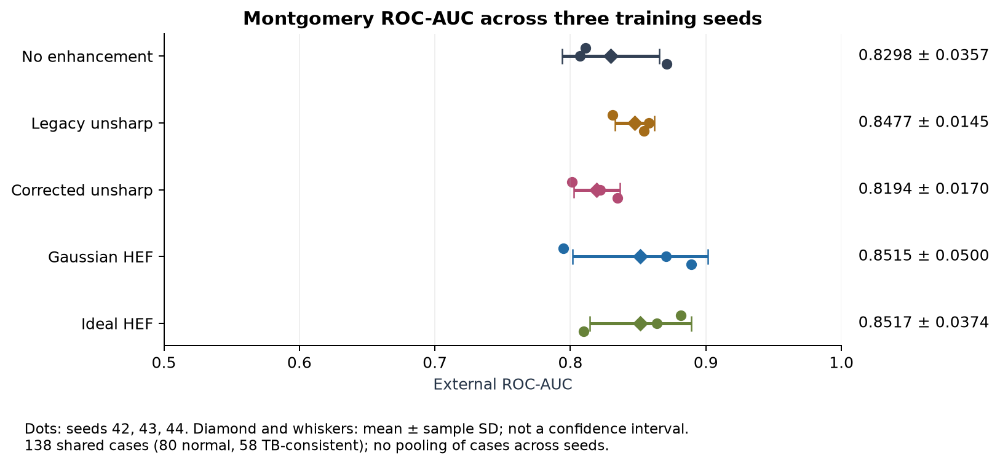
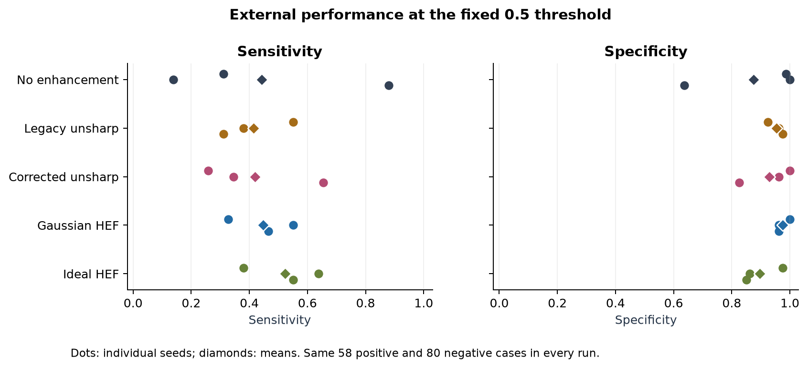

# Chest X-ray Enhancement for Tuberculosis Classification

## Final experimental report

**Project author:** Mohammad Albatayneh. **Results reviewed:** 19 October 2026. **Scope:** a controlled image-processing comparison, with AI-assisted software reconstruction and independent result checking. This report supersedes unsupported experimental interpretations in the original implementation report; original course materials remain unchanged in the private archive.

## Abstract

This study compares five preprocessing conditions for classifying normal versus TB-consistent chest radiographs with EfficientNet-V2-S. A fixed Shenzhen split supplies 529 training and 133 validation images; all 138 Montgomery images form the reserved external cohort. Each condition is trained for ten epochs using three matched seeds, producing 15 completed runs. The primary comparison, corrected unsharp versus no enhancement, yields mean external ROC-AUC 0.8194 versus 0.8298: difference -0.0104, paired 95% bootstrap interval [-0.0420, +0.0196]. Although exploratory HEF methods have higher point estimates, every enhancement-versus-control interval includes zero. These results do not establish an enhancement benefit. Predictions, metrics, histories, bootstrap calculations, and recorded provenance were checked; full weight-based replay remains outstanding because checkpoint binaries were not supplied for review.

## 1. Objective and historical corrections

The question is whether a specified image-enhancement transform changes TB-consistent versus normal classification when model architecture, development split, augmentation, initialization seed, optimization budget, and selection rule are controlled. It is not a test of clinical diagnostic utility, lesion localization, or faithful reproduction of every method in the three reviewed papers.

The original exploration mixed EfficientNet-V2-S/M, different random image splits, training recipes, and preprocessing. It had no untreated control or independent final test. Its validation headline numbers therefore cannot be ranked against this external-cohort experiment.

| Original issue | Corrected interpretation or treatment |
|---|---|
| M training loss 0.0360 combined with accuracy 0.9094 and AUC 0.9422 | Loss came from epoch 15; accuracy/AUC came from epoch 5. They are not one model-state result. |
| Both models claimed sensitivity and specificity above 90% | M confusion matrix `[[118,10],[14,123]]` gives sensitivity **89.78%** and specificity **92.19%**. S sensitivity was not verifiable from the cited cell. |
| S epoch-10 result described without selection context | Epoch 10: validation accuracy 0.9170/AUC 0.9653; epoch 9: 0.9245/0.9658. Neither is an external test. |
| Unsharp threshold calculated but not used in returned image | Preserve old behavior as `legacy_unsharp`; compare a signed, thresholded floating-point implementation separately. |
| Enhancement described as improving generalization | Treat as a hypothesis. The completed controlled comparison does not confirm a benefit. |
| Literature values mixed with project claims | Published results remain attributed to their authors and separate from this experiment. |

The full [audit and literature correction ledger](../PROJECT_AUDIT.md) also corrects transcription errors in the comparative study and bibliography. For example, Lin et al. is a 2020 article, number 4100218, not the cited alternative number/date; Ishikawa et al. is IEEE Access 13, 11080-11094 (2025). Those literature results are not measured contributions of this project.

## 2. Data and experimental design

| Dataset / split | Normal | TB-consistent | Total | Use |
|---|---:|---:|---:|---|
| Shenzhen / training | 261 | 268 | 529 | Optimization |
| Shenzhen / validation | 65 | 68 | 133 | Best-epoch selection |
| Montgomery / external test | 80 | 58 | 138 | Frozen final comparison |

The source cohorts contain 662 and 138 images respectively. The exported manifest and a repeated stratified split with seed 2026 reproduce these allocations exactly. There is no recorded case/group overlap or repeated byte/pixel hash. Images were not returned for independent rehashing. The preparation report uses case IDs rather than a verified patient mapping, so patient independence remains unverified.

The experiment holds five conditions constant across seeds 42, 43, and 44: no enhancement, legacy unsharp, corrected unsharp, Gaussian HEF, and Ideal HEF. The primary contrast was specified before external evaluation: corrected unsharp minus no enhancement in mean external ROC-AUC. Other comparisons are exploratory, without multiplicity adjustment.

## 3. Processing and training

Native image intensities are decoded without forced 8-bit conversion. Replicated grayscale RGB is collapsed to its identical intensity plane. Each nonconstant image is normalized to [0,1], resized with preserved aspect ratio, enhanced before padding, then centered on a 384 by 384 canvas. Three-channel replication and ImageNet normalization feed the model. Training rotation is at most 10 degrees with probability 0.5; evaluation has no random augmentation.

Unsharp uses a 5 by 5 Gaussian kernel, sigma 1, amount 1.5. Corrected unsharp uses signed residuals with threshold 10/255. Legacy unsharp retains historical uint8 quantization and ineffective threshold, so the legacy-versus-corrected pair is not a pure threshold-only ablation. HEF uses gain 0.5 + 1.5 times the high-pass response and cutoff (30/480) times the smaller unpadded image dimension in DFT bins. Exact formulas and boundaries are recorded in the [frozen protocol](RESEARCH_PROTOCOL.md).

EfficientNet-V2-S uses explicit ImageNet pretrained weights and a single-logit head. Optimization uses unweighted BCEWithLogitsLoss, SGD learning rate 0.01, momentum 0.9, weight decay 0.0005, and ten-epoch cosine decay to 0.000001. Model selection maximizes validation ROC-AUC, then minimizes validation loss, then selects the earlier epoch. The classification threshold is fixed at 0.5.

All runs use physical batch **8**, gradient accumulation to effective batch **32**, AMP, two data-loader workers, deterministic controls, and the same initialization seed for matched arms. BatchNorm sees eight samples, not 32. The actual runtime is Python 3.13.15, PyTorch 2.13.0+cu126, Torchvision 0.28.0+cu126 on a Tesla T4. Dependencies, configuration, epoch histories, and checkpoint metadata are retained.

## 4. External results

Values are arithmetic means over three separately trained seeds. The ROC-AUC standard deviation is sample SD across seeds, not a confidence interval. Accuracy, sensitivity, specificity, F1 and Brier are also seed means. The sample size remains 138 cases.

| Condition | ROC-AUC mean +/- SD | Accuracy | Sensitivity | Specificity | F1 | Brier |
|---|---:|---:|---:|---:|---:|---:|
| No enhancement | 0.8298 +/- 0.0357 | 69.32% | 44.25% | 87.50% | 0.4830 | 0.2306 |
| Legacy unsharp | 0.8477 +/- 0.0145 | 72.71% | 41.38% | 95.42% | 0.5528 | 0.1947 |
| Corrected unsharp | 0.8194 +/- 0.0170 | 71.50% | 41.95% | 92.92% | 0.5319 | 0.2103 |
| Gaussian HEF | 0.8515 +/- 0.0500 | 75.36% | 44.83% | 97.50% | 0.5984 | 0.1857 |
| Ideal HEF | 0.8517 +/- 0.0374 | 73.91% | 52.30% | 89.58% | 0.6207 | 0.1737 |

| Condition minus no enhancement | Mean ROC-AUC difference | Paired 95% interval | Role |
|---|---:|---:|---|
| Corrected unsharp | -0.01042 | [-0.04203, +0.01962] | Primary |
| Legacy unsharp | +0.01789 | [-0.02199, +0.05877] | Exploratory |
| Gaussian HEF | +0.02173 | [-0.02612, +0.07221] | Exploratory |
| Ideal HEF | +0.02195 | [-0.02044, +0.06552] | Exploratory |

Intervals use 2,000 stratified paired case/group bootstrap samples, seed 2026. Each draw uses the same case indices across all methods and seeds, computes one AUC per seed, then averages. Seed predictions are not treated as independent cases. These are conditional case-sampling intervals, not uncertainty from alternative development cohorts. Every difference interval contains zero; none establishes superiority. An interval spanning zero also does not establish equivalence or prove that the methods have identical performance.

The highest mean AUC is Ideal HEF (0.8517), closely followed by Gaussian HEF (0.8515). This descriptive ordering does not select a deployment winner. The highest individual AUC is Gaussian HEF seed 44 (0.8892), but selecting that seed after seeing test results would bias the conclusion.

## 5. Per-seed results and generalization

| Condition | Seed | Selected epoch | Validation AUC | External AUC | Sensitivity | Specificity |
|---|---:|---:|---:|---:|---:|---:|
| No enhancement | 42 | 10 | 0.9472 | 0.8112 | 31.03% | 98.75% |
| No enhancement | 43 | 8 | 0.9564 | 0.8072 | 13.79% | 100.00% |
| No enhancement | 44 | 7 | 0.9416 | 0.8709 | 87.93% | 63.75% |
| Legacy unsharp | 42 | 8 | 0.9516 | 0.8310 | 55.17% | 92.50% |
| Legacy unsharp | 43 | 7 | 0.9609 | 0.8579 | 37.93% | 96.25% |
| Legacy unsharp | 44 | 10 | 0.9566 | 0.8541 | 31.03% | 97.50% |
| Corrected unsharp | 42 | 9 | 0.9319 | 0.8011 | 25.86% | 100.00% |
| Corrected unsharp | 43 | 10 | 0.9322 | 0.8222 | 34.48% | 96.25% |
| Corrected unsharp | 44 | 7 | 0.9355 | 0.8348 | 65.52% | 82.50% |
| Gaussian HEF | 42 | 7 | 0.9672 | 0.7948 | 32.76% | 100.00% |
| Gaussian HEF | 43 | 9 | 0.9403 | 0.8705 | 55.17% | 96.25% |
| Gaussian HEF | 44 | 10 | 0.9368 | 0.8892 | 46.55% | 96.25% |
| Ideal HEF | 42 | 9 | 0.9491 | 0.8815 | 37.93% | 97.50% |
| Ideal HEF | 43 | 6 | 0.9503 | 0.8640 | 63.79% | 86.25% |
| Ideal HEF | 44 | 5 | 0.9414 | 0.8097 | 55.17% | 85.00% |

Every selected validation AUC exceeds its external AUC. The two cohorts differ in acquisition population, and validation performance is also affected by model selection. This pattern is consistent with a generalization gap; it does not isolate the causal contribution of domain shift, sampling, or overfitting.

At threshold 0.5, sensitivity varies substantially between seeds. For identity it ranges from 13.79% to 87.93%. Ranking metrics alone therefore do not describe the decision behavior. Brier scores and calibration plots are retained, but no model was recalibrated using Montgomery, and the threshold was not changed after test inspection.

All [15 learning histories](../reports/colab_2026-10-19/figures/all_learning_curves.png) and per-run confusion, ROC/PR, calibration, and learning plots are provided. Decreasing training loss with noisier validation loss supports monitoring generalization; augmented training loss and unaugmented validation loss are not directly interchangeable measures.

## 6. Verification, execution and resource record

The independent review verified 167 checksummed files, recomputed all 15 external and 15 validation metric dictionaries, reconciled 150 epoch records and all best-epoch choices, reproduced the split, and independently reproduced the paired bootstrap. All checks agreed. The returned Colab software log records 137 passed tests and one skipped offline-bootstrap test. Three additional tests of the independent review calculations passed. See [RESULTS_REVIEW.md](RESULTS_REVIEW.md).

The notebook records successful resumed execution; it is not evidence of one uninterrupted clean-session execution. Only its configured Drive root and a separately identified local-image-cache helper changed. All 32 pinned package files match the delivered implementation. Training code was not modified during this review.

Recorded train-plus-validation time totals **14,236.048 seconds (3 hours 57 minutes 16 seconds)** across 150 epochs, averaging 94.907 seconds per epoch. This includes data loading/preprocessing and excludes checkpoint saving, setup, acquisition, final evaluation and export; it is not isolated GPU compute time or total wall time. The preflight tested physical batch 8 and did not benchmark larger batches. No full-resource-utilization or measured optimization-speedup claim is made.

Metadata inventories 150 immutable checkpoint files totaling 24,374,793,282 bytes (22.70 GiB). The 15 selected files total 2,437,484,333 bytes (2.27 GiB). These are recorded sizes; checkpoint binaries remain outside the review package. Their metadata is consistent, but independent weight hashing and inference replay remain unverified.

## 7. Limitations and next research decisions

The external cohort is small and comes from one additional site. Case-based grouping does not prove independent patients. Complete original images, checkpoint binaries, demographic subgroup labels, transformed near-duplicate checks, and pretrained-data overlap evidence were not supplied for independent review. Three seeds provide limited optimization variability and do not represent all training cohorts. There is no prospective clinical or deployment validation.

No additional training is required to report this completed negative/inconclusive primary comparison honestly. If future work is undertaken, specify it as a new study: assess calibration and threshold behavior using development-only validation, improve development-cohort coverage, and reserve genuinely new external evidence. Do not optimize against Montgomery after these outcomes are known. Hardware batch/data-flow profiling should occur before freezing any future training suite.

## 8. Reproducibility and attribution

The public [aggregate evidence](../reports/colab_2026-10-19/README.md) includes full-precision metrics, per-run comparisons, configurations, environment, histories, checkpoint identities, uncertainty results, and figures. Private inputs are identified by SHA-256. Original reports and notebooks are preserved privately, while their audit corrections remain visible.

Datasets are attributed to the NLM/Shenzhen/Montgomery contributors; EfficientNetV2, pretrained weights, and libraries retain their authors' credits. See [REFERENCES.md](REFERENCES.md) and the [official dataset access page](https://lhncbc.nlm.nih.gov/CHRB/CHRB-resources.html). No dataset, third-party paper, or large checkpoint is republished. The owner has not selected a software license. AI-assisted reconstruction and review are disclosed; no new architecture or clinical efficacy contribution is claimed.
